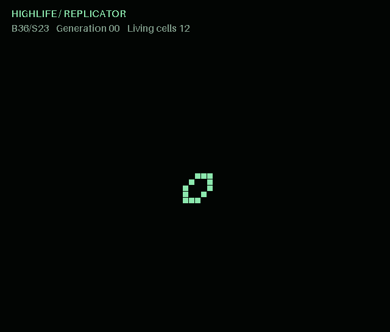
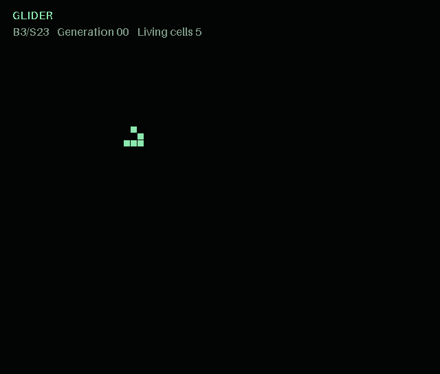
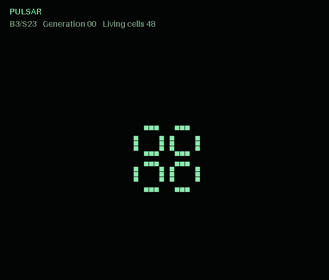
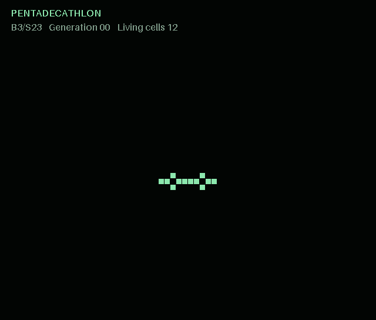
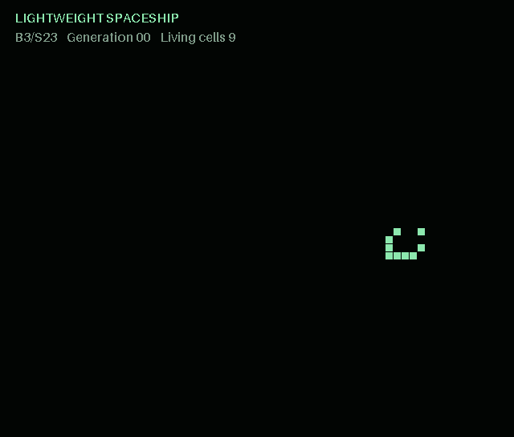
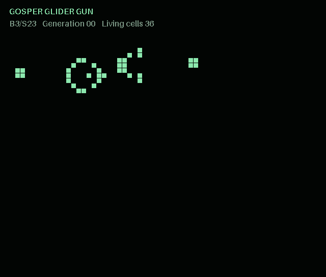

# Lifelike

A small Rust engine for Conway's Game of Life and other Life-like cellular
automata, with WebAssembly bindings and a browser viewer built with plain
HTML, CSS, and JavaScript.

Start with a handful of living cells, advance the simulation, and watch patterns
move, oscillate, or replicate. The same Rust engine powers both native use and
the web demo.



*HighLife replicator, generations 0–84. Generated with this project's engine;
the animation pauses before looping back to the initial state.*

## Rules

| Rule | Birth | Survival |
| --- | --- | --- |
| Conway | 3 neighbors | 2 or 3 neighbors |
| HighLife | 3 or 6 neighbors | 2 or 3 neighbors |
| Seeds | 2 neighbors | None |

Each cell has up to eight neighbors. The board is finite: positions outside its
boundaries are treated as dead, with no wrapping. Cells are packed into bytes
(eight cells per byte), and two buffers keep each generation's updates simultaneous.

## Pattern gallery

Five classic patterns from [ConwayLife's LifeWiki](https://conwaylife.com/wiki/).
These GIFs are generated locally with this project's Rust engine from the
[source patterns](docs/patterns/), using the same green and black palette as the
viewer. All five run under Conway's rule, B3/S23. Spaceships and the gun pause
before restarting; the oscillators loop continuously.

| Pattern | Animation |
| --- | --- |
| **[Glider](https://conwaylife.com/wiki/Glider)** — a small spaceship moving diagonally, one cell every four generations. |  |
| **[Pulsar](https://conwaylife.com/wiki/Pulsar)** — a symmetric oscillator that repeats every three generations. |  |
| **[Pentadecathlon](https://conwaylife.com/wiki/Pentadecathlon)** — a pulsating oscillator with a 15-generation cycle. |  |
| **[Lightweight spaceship](https://conwaylife.com/wiki/Lightweight_spaceship)** — an orthogonal spaceship moving two cells every four generations. |  |
| **[Gosper glider gun](https://conwaylife.com/wiki/Gosper_glider_gun)** — a stationary gun that emits a new glider every 30 generations. |  |

## Run the browser demo

You need a Rust toolchain supporting edition 2024,
`wasm-pack`, and Python 3 to serve
the files locally. Run these commands from the repository root:

```bash
rustup target add wasm32-unknown-unknown
wasm-pack build wasm --target web --out-dir ../examples/pkg
python3 -m http.server 8000 --directory examples
```

Open <http://localhost:8000>. Select a starting pattern, then use **Start**,
**Step**, **Reset**, or **Clear**. Click the board to toggle individual cells.
Choosing a preset also selects its rule: the replicator runs in HighLife.

The generated WASM package lives in `examples/pkg/` and is ignored by Git.
See [the example README](examples/README.md) for embedding the viewer in another
website without a bundler.

## Use the WebAssembly API

After building, import the generated module from a browser ES module:

```javascript
import init, { Universe, LifeRule } from "./pkg/lifelike_wasm.js";

await init();
const universe = new Universe(64, 48, LifeRule.Conway);
universe.setCell(2, 3, true);
universe.setCell(3, 4, true);
for (const col of [2, 3, 4]) universe.setCell(4, col, true);
universe.tick();

const alive = universe.getCell(3, 4);
const bytes = universe.cells(); // A Uint8Array copy of the current board.

universe.clear();
universe.free(); // Release the Rust allocation when finished.
```

Coordinates are zero-based `(row, column)`. Out-of-bounds reads return `false`;
out-of-bounds edits are ignored. `width()` and `height()` return the dimensions.
The generated package includes TypeScript declarations.

For packed cell data, cell `row * width + column` is stored in byte
`Math.floor(index / 8)`, at bit `7 - (index % 8)`.

## Project layout

- [`core/`](core/): the `lifelike` Rust library, the `Universe` trait, and the
  `BasicMatrixUniverse` implementation.
- [`wasm/`](wasm/): a small `wasm-bindgen` wrapper around the engine.
- [`examples/`](examples/): the browser demo and reusable `mountLife` viewer.
- [`core/examples/replicator.rs`](core/examples/replicator.rs): a native example
  that emits animation frames computed by the engine.
- [`scripts/render_animation.py`](scripts/render_animation.py): renders those
  frames as the GIF above; requires Pillow only when regenerating the image.

## Tests

```bash
cargo test --workspace
```

The tests cover initialization, packed storage, generation buffers, boundaries,
known patterns, all neighbor counts for each rule, and the WASM wrapper API.
To also execute the WASM tests in headless Firefox, install Firefox and run:

```bash
wasm-pack test --headless --firefox wasm
```

## Regenerate the animation

With Python 3 and [Pillow](https://pillow.readthedocs.io/) installed:

```bash
cargo run --quiet -p lifelike --example replicator \
  | python3 scripts/render_animation.py docs/assets/replicator.gif
```

Rust computes every generation; Python only draws the packed board data.
The source pattern is the [HighLife replicator](https://conwaylife.com/wiki/OCA:HighLife).

To regenerate the five gallery animations (from a Bash shell):

```bash
for pattern in glider pulsar pentadecathlon lwss gosper-glider-gun; do
  cargo run --quiet -p lifelike --example gallery -- "$pattern" \
    | python3 scripts/render_animation.py "docs/assets/$pattern.gif"
done
```

Each RLE file includes a link to its ConwayLife source. The GIFs are rendered by
this repository's scripts rather than copied from LifeWiki's image collection.

## License

[MIT](LICENSE).
